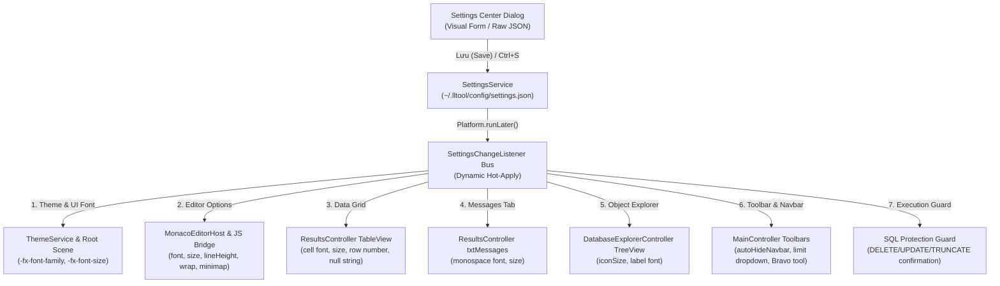

# Kế Hoạch Chuyển Đổi: Áp Dụng Toàn Diện Cài Đặt Vào Giao Diện (Settings UI Hot-Apply Plan)

> **Tài liệu tham chiếu:** `docs/LLTool_Java_Migration_3_Files/MIGRATION_TRACKER.md`  
> **Mã nguồn Python gốc:** `static/js/settings.js`, `theme.js`, `typography.js`, `autohide-navbar.js`, `grid-result.js`, `editor.js`  
> **Mục tiêu:** Hiện thực hóa cơ chế **Hot-Apply (Zero-Reload)** áp dụng toàn bộ các thiết lập từ `settings.json` vào các thành phần giao diện JavaFX tương ứng với bản Python.

---

## 1. Kiến Trúc Lan Truyền Cài Đặt (Reactive Event Bus)



---

## 2. Kế Hoạch Chi Tiết Theo Từng Phân Vùng Giao Diện

### Phân vùng 1: Toàn Cục & Thanh Điều Hướng (Main Window, Toolbar & TitleBar)
1. **Chủ đề màu sắc (`appearance.theme` / `theme`):**
   - **Hiện trạng:** Đã có `ThemeService` chuyển đổi AtlantaFX (`Primer Dark`, `Primer Light`, `Nord Dark`, `Cupertino Light`).
   - **Kế hoạch hoàn thiện:** Đồng bộ icon Mặt trăng/Mặt trời trên thanh công cụ và lưu trạng thái vào file `settings.json`.
2. **Phông chữ & Cỡ chữ UI (`appearance.uiFontFamily`, `appearance.uiFontSize`):**
   - **Cơ chế JavaFX:** Inject inline style hoặc dynamic CSS rule vào `Scene.getRoot()`:
     ```java
     root.setStyle(String.format(
         "-fx-font-family: '%s'; -fx-font-size: %dpx;",
         settings.getUiFontFamily(),
         settings.getUiFontSize()
     ));
     ```
   - **Phạm vi tác động:** Toàn bộ menu, thanh công cụ, các nút bấm, nhãn chữ, thanh trạng thái Status Bar và các dialogs.
3. **Tự động ẩn Menu / Toolbar (`appearance.autoHideNavbar`):**
   - **Cơ chế JavaFX:** 
     - Khi bật: Giảm chiều cao thanh Toolbar về 0 hoặc trượt lên trên (`TranslateTransition`).
     - Khi người dùng rê chuột vào vùng biên trên (Threshold $\le 6$px): Trượt thanh Toolbar xuống; khi chuột rời khỏi sau 400ms: Tự động trượt ẩn lại.
4. **Nút BRAVO Tool (`addons.bravo_tool.enabled`):**
   - **Cơ chế JavaFX:** Điều khiển `btnBravoTool.setVisible(enabled); btnBravoTool.setManaged(enabled);` trên thanh toolbar.
5. **Giới hạn số dòng truy vấn (`sql.maxRows` / `query.defaultLimit`):**
   - **Cơ chế JavaFX:** Đồng bộ giá trị chọn của ComboBox `queryLimit` trên toolbar chính về đúng số dòng cấu hình (0 = `All`, 100, 1000, 5000).

---

### Phân vùng 2: Trình Soạn Thảo SQL (Monaco Editor)
1. **Các tham số cấu hình:**
   - `editor.fontFamily`: Phông chữ code (Cascadia Mono Light, Consolas, JetBrains Mono, Fira Code).
   - `editor.fontSize`: Cỡ chữ code (pixel).
   - `editor.lineHeight`: Chiều cao dòng (hỗ trợ cả tỷ lệ 1.5 hoặc pixel).
   - `editor.letterSpacing`: Khoảng cách ký tự (pixel).
   - `editor.tabSize`: Độ rộng thụt lề Tab (2, 4, 8).
   - `editor.insertSpaces`: Chèn dấu cách thay cho ký tự Tab.
   - `editor.wordWrap`: Tự động ngắt dòng (`on` / `off`).
   - `editor.minimap`: Bật/tắt thanh xem trước thu nhỏ code bên phải.
   - `editor.keywordCase`: Định dạng từ khóa (UPPER, lower, preserve).
2. **Cơ chế cập nhật:**
   - Mở rộng hàm `updateEditorSettings(IdeSettings s)` trong `MonacoEditorHost.java` và `editor-bridge.js` để đẩy toàn bộ đối tượng options xuống `editor.updateOptions(opts)`.

---

### Phân vùng 3: Cây Đối Tượng (Object Explorer)
1. **Kích thước Icon (`appearance.iconSize`):**
   - **Hiện trạng:** Icon các node Database, Table, View, Column đang dùng `FontIcon` cố định kích thước 13-14px.
   - **Kế hoạch hoàn thiện:** Tạo cơ chế binding hoặc custom CellFactory nhận giá trị `iconSize` từ `SettingsService` (12px, 14px, 16px, 20px) để tự động co giãn kích thước icon trên cây thư mục.
2. **Phông chữ nhãn cây thư mục:** Kế thừa tự nhiên từ `uiFontFamily` và `uiFontSize`.

---

### Phân vùng 4: Bảng Kết Quả Truy Vấn (Data Grid)
1. **Phông chữ & Cỡ chữ Grid (`grid.fontFamily`, `grid.fontSize`):**
   - **Cơ chế JavaFX:** Cập nhật CSS style của `TableView` trong `ResultsController`:
     ```java
     resultsTable.setStyle(String.format(
         "-fx-font-family: '%s'; -fx-font-size: %dpx;",
         settings.getGrid().getFontFamily(),
         settings.getGrid().getFontSize()
     ));
     ```
   - Chiều cao mỗi dòng (Row Height) sẽ tự động tính toán co giãn theo cỡ chữ.
2. **Hiển thị cột số thứ tự dòng (`grid.showRowNumbers`):**
   - **Cơ chế JavaFX:** Cột đầu tiên `#` (Row Number Column) sẽ được `setVisible(settings.getGrid().isShowRowNumbers())`.
3. **Ký tự giá trị NULL (`grid.nullDisplayString`):**
   - **Cơ chế JavaFX:** Trong CellFactory của `ResultsController`, khi ô mang giá trị `null`, hiển thị nhãn text lấy từ `settings.getNullDisplayString()` (mặc định: `NULL`).
4. **Tự động mở panel kết quả (`sql.autoShowResultsPanel`):**
   - **Cơ chế JavaFX:** Khi người dùng nhấn F5 chạy query, nếu `autoShowResultsPanel == true` và SplitPane kết quả đang đóng/ẩn, tự động mở SplitPane và focus vào tab Results.

---

### Phân vùng 5: Tab Thông Báo SQL (Messages Tab)
1. **Phông chữ & Cỡ chữ Messages (`messages.fontFamily`, `messages.fontSize`):**
   - **Cơ chế JavaFX:** Cập nhật trực tiếp trên `txtMessages` (TextArea hiển thị log thực thi và lệnh PRINT):
     ```java
     txtMessages.setStyle(String.format(
         "-fx-font-family: '%s'; -fx-font-size: %dpx;",
         settings.getMessages().getFontFamily(),
         settings.getMessages().getFontSize()
     ));
     ```

---

### Phân vùng 6: Bảo Vệ Câu Lệnh SQL Nguy Hiểm (SQL Protection Guard)
1. **Thiết lập:** `sql.sqlprotection` (1 = Bật cảnh báo, 0 = Tắt).
2. **Cơ chế kiểm duyệt:**
   - Trong `MainController.handleExecuteQuery()`, trước khi gửi query xuống database, gọi hàm kiểm tra:
     - Câu lệnh chứa `DELETE` không có mệnh đề `WHERE`.
     - Câu lệnh chứa `UPDATE` không có mệnh đề `WHERE`.
     - Câu lệnh `TRUNCATE TABLE`.
   - Nếu phát hiện và `sqlprotection == 1`: Hiển thị hộp thoại cảnh báo `Alert(AlertType.CONFIRMATION)` màu đỏ yêu cầu người dùng xác nhận rõ ràng mới cho phép thực thi tiếp.

---

### Phân vùng 7: Khôi Phục Phiên Làm Việc (Session Restore)
1. **Thiết lập:** `session.restoreOnStartup` (true/false).
2. **Cơ chế JavaFX:**
   - Tích hợp với `WorkspaceDesktopManager`: Khi khởi động, nếu `restoreOnStartup == true`, tự động nạp lại danh sách các tab SQL từ phiên trước (`recent_tabs.json`). Nếu `false`, mở 1 tab truy vấn trống mặc định.

---

## 3. Lộ Trình Triển Khai (Roadmap & Checklists)

| Bước | Hạng mục công việc | File mã nguồn can thiệp | Kết quả kiểm thử |
| :---: | :--- | :--- | :--- |
| **Bước 1** | **Monaco Editor Bridge Hot-Apply**<br>Mở rộng truyền `fontFamily`, `lineHeight`, `letterSpacing`, `insertSpaces`, `wordWrap`, `minimap` | `MonacoEditorHost.java`<br>`editor-bridge.js` | Monaco thay đổi font, giãn dòng và ngắt dòng tức thì khi lưu Settings. |
| **Bước 2** | **Root Scene UI Typography & Theme**<br>Hot-apply `uiFontFamily` & `uiFontSize` lên toàn bộ giao diện qua Scene style | `MainController.java`<br>`ThemeService.java` | Toàn bộ chữ trên menu, toolbar, tab đổi font và co giãn cỡ chữ mượt mà. |
| **Bước 3** | **Data Grid & Messages Typography**<br>Đồng bộ font, cỡ chữ, cột số thứ tự `#` và nhãn `NULL` cho bảng kết quả và tab Messages | `ResultsController.java` | Bảng grid và tab Messages cập nhật font, size, nhãn NULL theo cấu hình. |
| **Bước 4** | **SQL Protection Guard**<br>Hộp thoại cảnh báo khi chạy `DELETE/UPDATE` không có `WHERE` hoặc `TRUNCATE` | `MainController.java` | Hiển thị Confirmation Dialog an toàn khi chạy lệnh nguy hiểm nếu bật bảo vệ. |
| **Bước 5** | **Toolbar & Navbar Enhancements**<br>Tự động ẩn toolbar (`autoHideNavbar`), ẩn/hiện nút Bravo Tool, đồng bộ Limit | `MainController.java`<br>`main-window.fxml` | Toolbar trượt ẩn thông minh; dropdown Limit đồng bộ với `maxRows`. |
| **Bước 6** | **Session Restore on Startup**<br>Khôi phục các tab đang mở từ phiên làm việc trước khi mở IDE | `EditorController.java`<br>`WorkspaceDesktopManager.java` | Mở lại đúng các tab đang soạn thảo dở từ lần tắt trước. |
| **Bước 7** | **Kiểm thử tự động toàn diện**<br>Bổ sung bộ test kiểm tra phản ứng của các thành phần UI khi nhận sự kiện cài đặt | `SettingsAndThemesTest.java` | 100% tests PASS không có lỗi hồi quy. |

