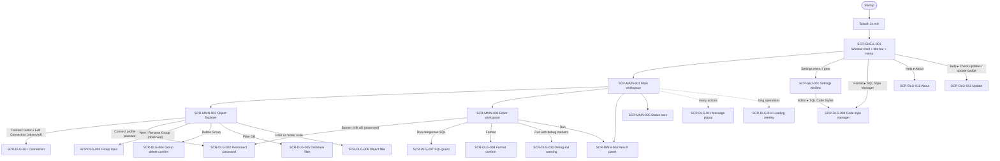

# Navigation Map — in-scope surfaces
# Bản đồ điều hướng (phạm vi đã duyệt)

Evidence: `code_verified` unless marked *(observed)*.

## Out-of-scope exits (recorded, `deferred`)

| From | Control | Opens |
|---|---|---|
| Navbar | Snippets · Sheets · BRAVO Tool | Snippets manager · Google Sheets window · BRAVO window |
| View menu | Object search · Query History · Compare results · Activity Monitor · Schema Compare · Google Sheets · Report Gen | tabs / sub-windows |
| Action bar | Plan · Compare · Syntax reference · History · File history · Object search · Import · Export · Split | feature views |
| Explorer context menu | SQL Trace Profiler · Activity Monitor · So sánh Schema · Design / Edit data / Dependencies … | sub-windows / tabs |
| Result panel | So sánh (compare results) | Result comparator |
